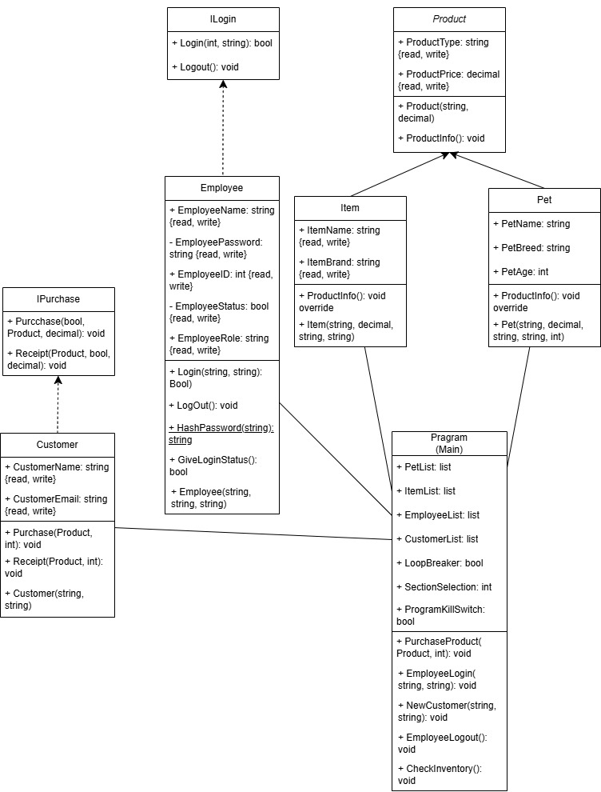

# AE1 Code Report (Condensed)

## Classes

Class Instances:

- Products (abstract)
- Item
- Pet
- Employee
- Customer

### Products

Class defining all the products in the store. Defined with price and product name and the function to check all details of a product.

### Item

Class defining all branded, shelf items that the store has for sale. Differentiated from the product class it inherits from by the item’s name and brand. The inherited characteristics, type and price reflect the type of item it is (e.g. dog food) and the item price.

### Pet

Class defining all pets the store stocks. The pet class is unique in having the pet’s breed, name and age. The inherited characteristics reflect the species of the animal (e.g. cat) and the price of the animal.

### Employee

The class under which employees of the company are defined. Each employee has a unique employee ID number, name and role. It’s holds the functions to login, log out, hash passwords and retrieve the login status of an employee.

### Customer

Class defining the repeat customers and ways customers can interact with the shop. Customers only have email addresses and preferred name(s) stored as they are the only information needed. They have the functions to purchase products and print a receipt of a product purchase.

## Objects

Object Instances:

- Employee
- Customer
- Pet
- Item

Employee objects are objects of the Employee class, they represent the workers of the store and hold the characteristics of them that matter to the code and systems of the store.

Customer objects are objects of the Customer class, representing the people that shop at the store. As the objects are not vital to the system they don’t have much information required to create an instance, just email and name.

Pet and Item objects are objects of the Pet and Item class respectively. These objects are how pets and items are represented in the system with vital information that the customer might want to know stored within them.

### Lists

- EmployeeList - List of Employee class objects
- CustomerList - List of Customer class objects
- PetList - List of Pet class objects
- ItemList - List of Item class objects

EmployeeList, CustomerList, PetList, ItemList are all lists established in the main section of code. They store all the data used throughout the program, including additions of new customers and accessing products to show customers.

## Encapsulation

Encapsulation Instances:

- EmployeeStatus - Private
- EmployeePassword - Private
- Class fields

Good examples of strong encapsulation occur within the Employee class. Both the status and password of the employee are private, meaning they are only accessible within the employee class itself, encapsulating them to that part of the code for increased security.

However, encapsulation is used throughout the code with all specific code contained within its relevant class. All class fields and functions related to an object are encapsulated within the class code and accessed via calls in the main section of code.

## Constructors

Constructor Instances:

- Employee constructor
- Customer constructor
- Product constructor
- Item constructor
- Pet constructor

Every class in the code is accompanied by constructors so that they can be initialised in the code with the accompanying data. Each constructor takes the arguments needed to create an object, for example the customer constructor takes in an email and name.

The constructor for the Product class is unique as it is never actually directly used since Product is an abstract class. It is however integrated within the constructors of Item and Pet since they inherit from the Product class.

## Inheritance

Inheritance Instances:

- Pet
- Item

These are the only instances of inheritance in the code. Both the above classes inherit two attributes, a function and part of the constructor from the Product abstract class. Since both pets and items have prices and names and customers would want information on both, they are commonly defined in Product for use in both classes.

The ProductInfo() function pulls information about a product (pet or item) and displays it in the console. This is inherited from the Product class and overridden to display specific information for pets or items.

## Polymorphism

The only instance of polymorphism in the test is the ProductInfo() function. The function displays polymorphism through its versatility of usage. The function displays different information depending on the type of object it is called upon.

- If called upon an item, the function returns name, brand, price and type of item.
- If called upon a pet, the function returns name, breed, age type (species) and price of the pet.

---

## UML Diagram

The UML diagram of this code visually represents the structure of my code, including all classes, interfaces and the links between them and the main function of the program.

The inheritance within the program is clearly visible with both Pet and Item classes connected to the Parent class. The function and attributes are also visible in the Pet and Item class.

All of the relationships between the main function and classes are visible, demonstrating how, while independent, classes are linked and can interact in the main section of code.

